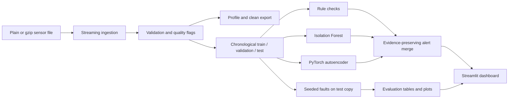

# SensorGuard

SensorGuard is a reproducible data-quality and anomaly-investigation pipeline for the Intel Berkeley Research Lab sensor dataset. It keeps malformed and suspicious readings auditable, evaluates detectors against controlled synthetic faults, and provides an interactive Streamlit dashboard. The historical data is unlabeled: naturally occurring patterns are candidates for investigation, not verified failures.

CI runs on pushes and pull requests through [GitHub Actions](./.github/workflows/ci.yml). A repository-specific badge can be added after publishing this folder to a known GitHub owner/repository.

## What it does

- Streams plain text or gzip records and preserves raw line evidence.
- Validates timestamps, sensor identifiers, values, duplicates, ordering and sampling gaps.
- Produces configurable rule findings, Isolation Forest scores and PyTorch autoencoder reconstruction errors.
- Uses chronological train/validation/test partitions; fits preprocessing on training rows and calibrates model thresholds on unmodified validation data (not independently verified fault-free).
- Injects seeded synthetic faults into a separate held-out copy and records the changed readings and ground truth.
- Reports feature-reading pair metrics against synthetic labels, no-injection test alert rates, fault-type results and exploratory voltage cases.
- Serves cached data and precomputed results in a five-section Streamlit dashboard; the UI does not train models.

## Architecture



## Requirements and setup

Python 3.10 or newer is required. Install the package and development/dashboard tools from the repository root:

```powershell
python -m venv .venv
.\.venv\Scripts\Activate.ps1
python -m pip install --upgrade pip
python -m pip install -e ".[dev,dashboard]"
python -m pytest -q
```

Linux/macOS activation is `source .venv/bin/activate`. CPU inference and training are supported; CUDA is optional. CI uses Python 3.11 and synthetic data only.

## Data provenance and placement

The source is the [Intel Berkeley Research Lab sensor dataset](https://db.csail.mit.edu/labdata/labdata.html). The original records were collected by the Intel Research Berkeley lab deployment. Cite and acknowledge the dataset documentation when reusing it. This project does not redistribute the raw data. Place the local file at `data.txt/data.txt` or pass a path explicitly. The discovered local source was a 150,910,946-byte plain-text file; it remains unchanged and is excluded from Git.

The records contain date, time, per-sensor epoch sequence, mote ID, temperature, humidity, light and voltage. Epoch is not globally unique. The official page describes IDs 1–54 and notes that data from some motes may be missing or truncated. This local file contains all IDs 1–54, additional IDs 55–58, and isolated IDs 6485, 33117 and 65407. SensorGuard preserves these records and flags IDs outside the configured 1–54 range rather than forcing a 54-sensor count.

The initial profile counted 93,879 rows as short because whitespace collapsing removed empty columns. The raw file uses repeated spaces for missing columns and five trailing spaces on a terminal block of 526 rows. Preserving literal spaces maps all 2,313,682 records to eight positional columns: 92,976 rows have blank light, 373 have blank temperature/humidity/light, four other rows have unusual IDs/blank positions, and the final 526 have blank mote ID and all measurement slots. These 526 rows form the contiguous file suffix. They remain unassigned to any sensor; their physical cause cannot be established from the file. Every row retains its raw text and line number. Explicit empty measurements remain missing values, not discarded rows. The full profile measures 2,312,781 temperature, 2,312,780 humidity, 2,219,804 light and 2,313,156 voltage values. The one-pass profiler also measures 0 repeated (timestamp, sensor ID) keys, 227,392 input-order reversals, and 231,380 consecutive per-sensor intervals over 300 seconds. Under the documented screening bounds, it flags 388,857 temperature, 299,084 humidity, 0 light and 1 voltage values; these are heuristic findings, not confirmed faults. The profiler records elapsed time and peak working set in its report. Out-of-range readings remain in the data.

## Reproduce the data pipeline

Profile the dataset without retaining the complete file in memory. The profiler measures field counts, parsed timestamp coverage, sensor counts, feature ranges/missingness and input-order gaps. Its report goes to the ignored `artifacts/` directory.

```powershell
python scripts/profile_dataset.py "data.txt/data.txt"
python scripts/profile_dataset.py "C:\path\to\data.txt.gz"
```

The parser and chunk reader are available from `sensorguard.ingestion`; `validate_frame()` annotates rows without deleting suspicious observations. `clean_frame()` creates a derived representation while carrying issue evidence forward. Keep raw data immutable and treat generated exports as reproducible artifacts.

## Train detectors and export alerts

The training CLI materializes its input as a DataFrame. Do not pass the complete 2.3-million-row source on a memory-constrained machine. Instead, run the bounded experiment below; it saves the exact unmodified sample to `sampled_records.csv`. Then fit models and export predictions from that sample:

```powershell
python scripts/run_detectors.py artifacts/all_sensors_250/sampled_records.csv `
  --output artifacts/all_sensors_250/trained_predictions.csv `
  --model-dir artifacts/all_sensors_250/models `
  --epochs 3 `
  --threshold-quantile 0.99
```

The command saves `isolation_forest.joblib` and `autoencoder.pt`, and writes chronological test predictions. `sensorguard-detect` is the equivalent installed entry point. Missing values are imputed in model preprocessing; the source records and quality findings remain available in the sampled input.

## Controlled evaluation and metric meaning

Run a deterministic bounded sample experiment across every observed source ID. This includes IDs outside the official expected range; they are kept so the rule detector can surface them. Set the cap and epochs to fit available memory and runtime:

```powershell
$sensorIds = (1..58) + @(6485, 33117, 65407)
$sensors = $sensorIds -join ','
python scripts/run_experiment.py `
  --input "data.txt/data.txt" `
  --output-dir artifacts/all_sensors_250 `
  --sensors $sensors `
  --max-per-sensor 250 `
  --seed 42 `
  --epochs 3
```

The runner scans the source, retains at most the first N source-order rows per requested ID, removes isolated records outside a two-day neighborhood around the selected sample median, and sorts the bounded sample chronologically. It fits on unmodified training data, calibrates model thresholds on the unmodified validation score distribution, and injects faults only into a copy of the held-out test partition. Unmodified does not mean verified fault-free. The evaluation unit is a sensor-feature-reading pair (timestamp-only edits use a record marker). Threshold calibration uses validation data only; final test labels are not used to fit or calibrate. Because only injected modifications have known labels, precision, F1, false-positive rate, true negatives, and PR curves are withheld for this partially labeled set. The report instead gives injected-pair recall, missed injected pairs, and descriptive alert rates on unlabeled readings. It also includes per-fault, per-sensor, detector/feature and rule-contribution breakdowns, distinct alerted-reading counts, and delay for supported span faults. Combined alerts are deduplicated per pair and scored as OR decisions.

The experiment directory contains `sampled_records.csv`, split/test records, injected observations and manifest, per-pair prediction details, detector metrics, no-injection alert baseline, per-fault and per-sensor tables, detector/feature/rule and distinct-reading alert breakdowns, threshold metadata, voltage candidates, plots, and `experiment_report.md`. Unmodified observations have no verified labels, so their alerts are descriptive rather than false-positive counts.

### Latest measured bounded experiment and diagnosis

The full one-pass profile processed 2,313,682 rows in 78.47 seconds with a measured peak working set of 329.6 MiB on this Windows environment. The bounded evaluation scanned the source and selected up to 250 source-order records for each of the 61 observed IDs, then retained 12,977 rows in its dense time window (1,064 outside-window rows excluded). The chronological split was 7,786 train, 2,595 validation, and 2,596 test rows. It injected 3 events affecting 11 feature-reading pairs, evaluated 12,980 pairs, and completed the detector experiment in about 44 seconds; training/export on the saved sample took about 18 seconds. The saved evaluation threshold quantile was 0.99.

These figures supersede the earlier confusion table, which treated every unmodified reading as a verified negative. That assumption was not supported by the unlabeled source, so the old precision and apparent-FPR values are withdrawn as accuracy claims. The current run has 12,980 sensor-feature-reading pairs, 11 directly modified positives, and 12,969 unlabeled pairs. No real-world precision, F1 or false-positive rate can be established from this sample.

| Detector / ablation | Injected TP / FN | Injection recall | Alerts on unlabeled pairs | Unlabeled alert rate |
|---|---:|---:|---:|---:|
| Rules | 11 / 0 | 1.0000 | 3,014 | 0.2324 |
| Isolation Forest | 0 / 11 | 0.0000 | 818 | 0.0631 |
| Autoencoder | 1 / 10 | 0.0909 | 873 | 0.0673 |
| Quality-rule baseline | 5 / 6 | 0.4545 | 167 | 0.0129 |
| Statistical-rule baseline | 6 / 5 | 0.5455 | 2,847 | 0.2195 |
| Combined rules + IF + AE | 11 / 0 | 1.0000 | 3,754 | 0.2895 |

The 11 injected positives span three synthetic events (one spike, five drift points and five missing-block pairs). Thresholds use the training-fitted preprocessing and the 99th percentile of unmodified validation scores; the final test injections do not participate in fitting or threshold selection. The 12,977-row sample has chronological partitions of 7,786 / 2,595 / 2,596 train/validation/test records. The unlabeled alert rates are descriptive only: an alert outside an injected pair may be a false alert, a natural anomaly, or an unverified condition.

The earlier baseline run (same seed and split) emitted 4,870 rules alert pairs and 5,603 pairs in the all-detector union (including 11 injected pairs). The recalibrated run emits 3,025 rules pairs and 3,765 combined pairs, reductions of 37.9% and 32.8%. These are alert-volume reductions, not demonstrated specificity or precision improvements. The dominant statistical rule, `sensor_baseline_deviation`, fell from 4,673 to 2,812 pairs. Its former fixed robust-z threshold divided by a near-zero `1e-6` MAD floor and caused extreme scores on nearly constant sensor features. The rule now uses training-derived per-feature scale floors and per-feature robust-z cutoffs calibrated at the 99th percentile of validation scores. Floors remain configurable and are safeguards, not physical truth.

In the recalibrated run, the quality-rule ablation generated 172 pairs versus 2,853 for the statistical-rule ablation. Quality rules catch data-integrity and physical-limit conditions; statistical deviations dominate volume and require contextual review. Multivariate detector outputs are record-level scores projected onto present feature rows for investigation. The report and dashboard therefore expose both deduplicated feature-pair alerts and distinct sensor-timestamp readings, plus per-sensor, per-feature, per-rule, and detector contributions. Alert suppression/grouping has not been introduced: repeated findings must remain traceable to the source reading until an operational incident policy is defined.

Historical voltage patterns remain candidates only. Voltage is strongly related to temperature in the dataset; analysis adjusts for a per-sensor linear temperature relationship but cannot make a causal attribution. No independent battery-failure labels are available. The detector is an exploratory research pipeline, not an unattended or production-validated alarm system.

A smaller four-sensor smoke run (100 rows per ID, seed 42, two epochs) completed in about 30 seconds and produced 386 sample rows, 78 test rows, and the same 3 injected events. Generated artifacts are local under `artifacts/` and excluded from Git. These runs exercise the full detector workflow on a bounded sample, not model training over every raw record.

## Dashboard

```powershell
$env:SENSORGUARD_DATA_PATH = "data.txt/data.txt"
$env:SENSORGUARD_EXPERIMENT_DIR = "artifacts/all_sensors_250"
$env:SENSORGUARD_PROFILE_PATH = "artifacts/data_profile.md"
$env:SENSORGUARD_MODEL_DIR = "artifacts/all_sensors_250/models"
streamlit run app.py
```

Overview displays available profile and experiment outputs; Sensor explorer plots bounded sensor readings and peer references; Alert investigation filters and exports precomputed findings; Alert review collects independent labels; Model evaluation separates synthetic metrics from unlabeled case studies; Sensor health summarizes completeness, gaps, alerts and candidate voltage signals. Missing artifacts or data produce empty states. Set `SENSORGUARD_DATA_PATH`, `SENSORGUARD_EXPERIMENT_DIR`, `SENSORGUARD_PROFILE_PATH`, `SENSORGUARD_MODEL_DIR` and `SENSORGUARD_REVIEW_STORE` to configure paths. The data has no timezone metadata and the dashboard presents timestamps as recorded.

### Human alert review demo

Generate a small experiment artifact set and start the dashboard:

```powershell
.\.venv\Scripts\python.exe scripts\run_experiment.py `
  --input "data.txt/data.txt" `
  --output-dir artifacts\phase3-demo `
  --sensors 1,2,3,4 `
  --max-per-sensor 100 `
  --seed 42 `
  --epochs 2
$env:SENSORGUARD_DATA_PATH = "data.txt/data.txt"
$env:SENSORGUARD_EXPERIMENT_DIR = "artifacts/phase3-demo"
$env:SENSORGUARD_REVIEW_STORE = ".sensorguard/reviews.sqlite3"
streamlit run app.py
```

Open **Alert review**, filter the unmodified historical alert list, select an alert, inspect its sensor, recorded timestamp, feature value, detector, score/severity and explanation, then choose **Confirmed anomaly**, **Normal behavior**, or **Uncertain / needs investigation**. Add optional evidence notes and press **Save review decision**. A saved decision can be revisited and updated. The page excludes predictions from the synthetic-injection copy so generated test faults cannot be mistaken for historical findings. The Model evaluation page separately reports the class balance and confirmation rate among matched, binary-reviewed alerts; this selected-alert rate is descriptive, not recall or dataset-wide precision.

By default, feedback is stored in `.sensorguard/reviews.sqlite3`, separate from raw readings, prediction files and model artifacts. Set `SENSORGUARD_REVIEW_STORE` to use another local path. The `.sensorguard/` directory is ignored by Git. Use **Download review backup (JSON)** to export a versioned portable backup. Import validates the schema, labels, identities, timestamps and duplicate IDs before writing. If imported IDs already exist, import stops without writing anything unless the reviewer explicitly checks the overwrite confirmation. Store updates and imports use SQLite transactions.

Alert IDs are SHA-256 hashes of the recorded timestamp, sensor ID, feature, observed value and detector identity. Scores and explanations are omitted so recalibrating a detector does not change identity for the same reading and detector. A changed value, sensor, timestamp, feature or detector yields a different ID. Current prediction exports do not contain a unique raw-line identifier, so physically duplicated source rows with identical identity fields cannot be distinguished; they collapse to one reviewable identity. Reviews only match the current evaluation artifact when its alert ID matches exactly. Uncertain and unlabeled examples are excluded from binary reviewed-alert summaries. Feedback never retrains a detector, changes thresholds, or enters the synthetic-test metrics. Back up the JSON export somewhere separate from this working directory; local reviews are not synchronized or encrypted by SensorGuard.

For screenshots, launch the app, open each sidebar section and capture the browser view. Label any screenshots showing injected faults as synthetic evaluation results.

## Development and CI

```powershell
ruff check .
ruff format --check .
python -m pytest -q
```

GitHub Actions installs the package with dashboard/development extras, runs Ruff lint and format checks, executes the test suite and explicitly runs the small end-to-end experiment. The CI job does not use the local raw dataset, trained checkpoints or GPU. Use the same commands locally before submitting changes.

## Limitations and next steps

The rule limits are configurable heuristics; contextual differences can reflect legitimate local conditions. The bounded experiment is sensitive to sample window and injection choices, and its measured false-alarm rates are currently high. The convenience detector-training script loads its complete input in memory. Better labeled field failures, calibrated operational thresholds, streaming model training, broader sensor/time coverage and independent battery ground truth are needed before operational use.
