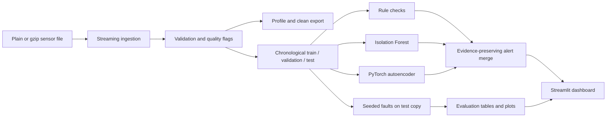

# SensorGuard

SensorGuard is a reproducible data-quality and anomaly-investigation pipeline for the Intel Berkeley Research Lab sensor dataset. It keeps malformed and suspicious readings auditable, evaluates detectors against controlled synthetic faults, and provides an interactive Streamlit dashboard. The historical data is unlabeled: naturally occurring patterns are candidates for investigation, not verified failures.

CI runs on pushes and pull requests through [GitHub Actions](./.github/workflows/ci.yml). A repository-specific badge can be added after publishing this folder to a known GitHub owner/repository.

## What it does

- Streams plain text or gzip records and preserves raw line evidence.
- Validates timestamps, sensor identifiers, values, duplicates, ordering and sampling gaps.
- Produces configurable rule findings, Isolation Forest scores and PyTorch autoencoder reconstruction errors.
- Uses chronological train/validation/test partitions; fits preprocessing on training rows and calibrates model thresholds on unmodified validation data (not independently verified fault-free).
- Injects seeded synthetic faults into a separate held-out copy and records the changed readings and ground truth.
- Reports feature-reading pair metrics against synthetic labels, no-injection test alert rates, fault-type results and exploratory voltage cases.
- Serves cached data and precomputed results in a five-section Streamlit dashboard; the UI does not train models.

## Architecture



## Requirements and setup

Python 3.10 or newer is required. Install the package and development/dashboard tools from the repository root:

```powershell
python -m venv .venv
.\.venv\Scripts\Activate.ps1
python -m pip install --upgrade pip
python -m pip install -e ".[dev,dashboard]"
python -m pytest -q
```

Linux/macOS activation is `source .venv/bin/activate`. CPU inference and training are supported; CUDA is optional. CI uses Python 3.11 and synthetic data only.

## Data provenance and placement

The source is the [Intel Berkeley Research Lab sensor dataset](https://db.csail.mit.edu/labdata/labdata.html). The original records were collected by the Intel Research Berkeley lab deployment. Cite and acknowledge the dataset documentation when reusing it. This project does not redistribute the raw data. Place the local file at `data.txt/data.txt` or pass a path explicitly. The discovered local source was a 150,910,946-byte plain-text file; it remains unchanged and is excluded from Git.

The records contain date, time, per-sensor epoch sequence, mote ID, temperature, humidity, light and voltage. Epoch is not globally unique. The official page describes IDs 1–54 and notes that data from some motes may be missing or truncated. This local file contains all IDs 1–54, additional IDs 55–58, and isolated IDs 6485, 33117 and 65407. SensorGuard preserves these records and flags IDs outside the configured 1–54 range rather than forcing a 54-sensor count.

The initial profile counted 93,879 rows as short because whitespace collapsing removed empty columns. The raw file uses repeated spaces for missing columns and five trailing spaces on a terminal block of 526 rows. Preserving literal spaces maps all 2,313,682 records to eight positional columns: 92,976 rows have blank light, 373 have blank temperature/humidity/light, four other rows have unusual IDs/blank positions, and the final 526 have blank mote ID and all measurement slots. These 526 rows form the contiguous file suffix. They remain unassigned to any sensor; their physical cause cannot be established from the file. Every row retains its raw text and line number. Explicit empty measurements remain missing values, not discarded rows. The full profile measures 2,312,781 temperature, 2,312,780 humidity, 2,219,804 light and 2,313,156 voltage values. The one-pass profiler also measures 0 repeated (timestamp, sensor ID) keys, 227,392 input-order reversals, and 231,380 consecutive per-sensor intervals over 300 seconds. Under the documented screening bounds, it flags 388,857 temperature, 299,084 humidity, 0 light and 1 voltage values; these are heuristic findings, not confirmed faults. The profiler records elapsed time and peak working set in its report. Out-of-range readings remain in the data.

## Reproduce the data pipeline

Profile the dataset without retaining the complete file in memory. The profiler measures field counts, parsed timestamp coverage, sensor counts, feature ranges/missingness and input-order gaps. Its report goes to the ignored `artifacts/` directory.

```powershell
python scripts/profile_dataset.py "data.txt/data.txt"
python scripts/profile_dataset.py "C:\path\to\data.txt.gz"
```

The parser and chunk reader are available from `sensorguard.ingestion`; `validate_frame()` annotates rows without deleting suspicious observations. `clean_frame()` creates a derived representation while carrying issue evidence forward. Keep raw data immutable and treat generated exports as reproducible artifacts.

## Train detectors and export alerts

The training CLI materializes its input as a DataFrame. Do not pass the complete 2.3-million-row source on a memory-constrained machine. Instead, run the bounded experiment below; it saves the exact unmodified sample to `sampled_records.csv`. Then fit models and export predictions from that sample:

```powershell
python scripts/run_detectors.py artifacts/all_sensors_250/sampled_records.csv `
  --output artifacts/all_sensors_250/trained_predictions.csv `
  --model-dir artifacts/all_sensors_250/models `
  --epochs 3 `
  --threshold-quantile 0.99
```

The command saves `isolation_forest.joblib` and `autoencoder.pt`, and writes chronological test predictions. `sensorguard-detect` is the equivalent installed entry point. Missing values are imputed in model preprocessing; the source records and quality findings remain available in the sampled input.

## Controlled evaluation and metric meaning

Run a deterministic bounded sample experiment across every observed source ID. This includes IDs outside the official expected range; they are kept so the rule detector can surface them. Set the cap and epochs to fit available memory and runtime:

```powershell
$sensorIds = (1..58) + @(6485, 33117, 65407)
$sensors = $sensorIds -join ','
python scripts/run_experiment.py `
  --input "data.txt/data.txt" `
  --output-dir artifacts/all_sensors_250 `
  --sensors $sensors `
  --max-per-sensor 250 `
  --seed 42 `
  --epochs 3
```

The runner scans the source, retains at most the first N source-order rows per requested ID, removes isolated records outside a two-day neighborhood around the selected sample median, and sorts the bounded sample chronologically. It fits on unmodified training data, calibrates model thresholds on the unmodified validation score distribution, and injects faults only into a copy of the held-out test partition. Unmodified does not mean verified fault-free. The evaluation unit is a sensor-feature-reading pair (timestamp-only edits use a record marker). Threshold calibration uses validation data only; final test labels are not used to fit or calibrate. It reports precision, recall, F1, apparent false-positive rate, confusion counts, sample/event counts, PR curves for individual detectors, per-fault and per-sensor metrics, and delay for supported span faults. Combined alerts are deduplicated per pair and scored as OR decisions; combined PR-AUC is omitted because detector score scales are incomparable.

The experiment directory contains `sampled_records.csv`, split/test records, injected observations and manifest, per-pair prediction details, detector metrics, no-injection alert baseline, per-fault and per-sensor tables, threshold metadata, voltage candidates, plots, and `experiment_report.md`. Treat no-injection alerts and controlled-test false positives as apparent rates: the historical source has no verified anomaly labels.

### Latest measured full-source subset experiment

The full one-pass profile processed 2,313,682 rows in 78.47 seconds with a measured peak working set of 329.6 MiB on this Windows environment. The bounded evaluation scanned the source and selected up to 250 source-order records for each of the 61 observed IDs, then retained 12,977 rows in its dense time window (1,064 outside-window rows excluded). The chronological split was 7,786 train, 2,595 validation, and 2,596 test rows. It injected 3 events affecting 11 feature-reading pairs, evaluated 12,980 pairs, and completed the detector experiment in about 44 seconds; training/export on the saved sample took about 18 seconds. The saved evaluation threshold quantile was 0.99.

| Detector | Precision | Recall | F1 | Apparent FPR | FP / FN |
|---|---:|---:|---:|---:|---:|
| Rules | 0.0023 | 1.0000 | 0.0045 | 0.3747 | 4,859 / 0 |
| Isolation Forest | 0.0000 | 0.0000 | 0.0000 | 0.0631 | 818 / 11 |
| Autoencoder | 0.0011 | 0.0909 | 0.0023 | 0.0673 | 873 / 10 |
| Combined rules + IF + AE | 0.0020 | 1.0000 | 0.0039 | 0.4312 | 5,592 / 0 |

The denominator is 12,980 feature-reading pairs with 11 injected positives. The very low precision reflects the sparse, experimenter-selected injections and large numbers of alerts; the combined system also flags many unlabelled pairs. In the rules output, numerous alerts are sensor-baseline deviations, and the broader sample includes IDs outside the configured expected set and out-of-range values. Do not interpret these apparent false positives as verified sensor faults, but do treat them as evidence that these thresholds are unsuitable for unattended alerting. On the unmodified held-out test subset, apparent alert rates were 0.374 for rules, 0.063 for Isolation Forest, 0.067 for the autoencoder, and 0.431 for the all-detector union. Historical battery patterns remain candidates only; temperature is correlated with voltage, and there is no independent failure ground truth.

A smaller four-sensor smoke run (100 rows per ID, seed 42, two epochs) completed in about 30 seconds and produced 386 sample rows, 78 test rows, and the same 3 injected events. Generated artifacts are local under `artifacts/` and excluded from Git. These runs exercise the full detector workflow on a bounded sample, not model training over every raw record.

## Dashboard

```powershell
$env:SENSORGUARD_DATA_PATH = "data.txt/data.txt"
$env:SENSORGUARD_EXPERIMENT_DIR = "artifacts/all_sensors_250"
$env:SENSORGUARD_PROFILE_PATH = "artifacts/data_profile.md"
$env:SENSORGUARD_MODEL_DIR = "artifacts/all_sensors_250/models"
streamlit run app.py
```

Overview displays available profile and experiment outputs; Sensor explorer plots bounded sensor readings and peer references; Alert investigation filters and exports precomputed findings; Model evaluation separates synthetic metrics from unlabeled case studies; Sensor health summarizes completeness, gaps, alerts and candidate voltage signals. Missing artifacts or data produce empty states. Set `SENSORGUARD_DATA_PATH`, `SENSORGUARD_EXPERIMENT_DIR`, `SENSORGUARD_PROFILE_PATH` and `SENSORGUARD_MODEL_DIR` to configure paths. The data has no timezone metadata and the dashboard presents timestamps as recorded.

For screenshots, launch the app, open each sidebar section and capture the browser view. Label any screenshots showing injected faults as synthetic evaluation results.

## Development and CI

```powershell
ruff check .
ruff format --check .
python -m pytest -q
```

GitHub Actions installs the package with dashboard/development extras, runs Ruff lint and format checks, executes the test suite and explicitly runs the small end-to-end experiment. The CI job does not use the local raw dataset, trained checkpoints or GPU. Use the same commands locally before submitting changes.

## Limitations and next steps

The rule limits are configurable heuristics; contextual differences can reflect legitimate local conditions. The bounded experiment is sensitive to sample window and injection choices, and its measured false-alarm rates are currently high. The convenience detector-training script loads its complete input in memory. Better labeled field failures, calibrated operational thresholds, streaming model training, broader sensor/time coverage and independent battery ground truth are needed before operational use.
