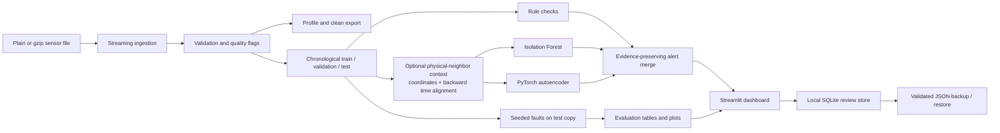
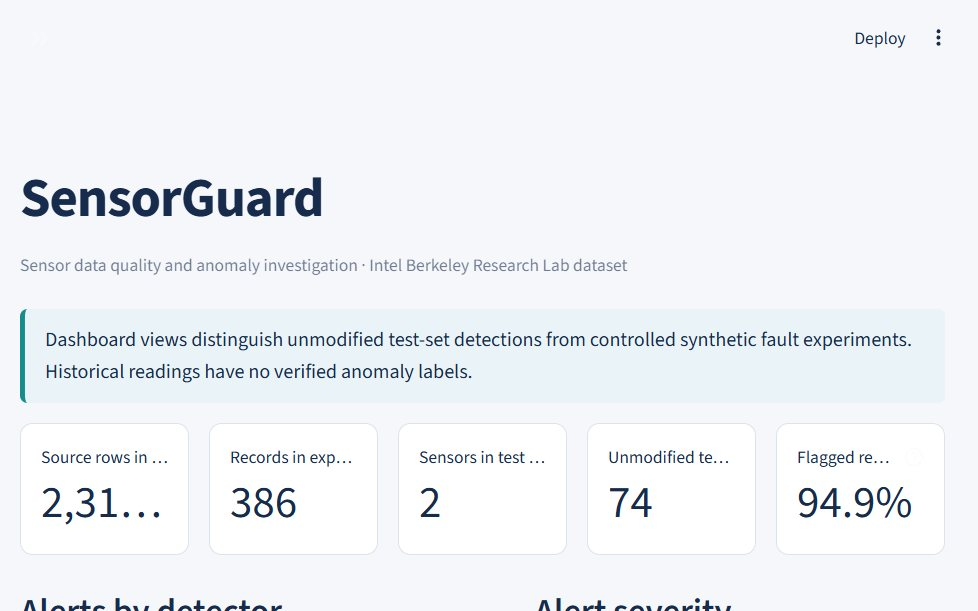
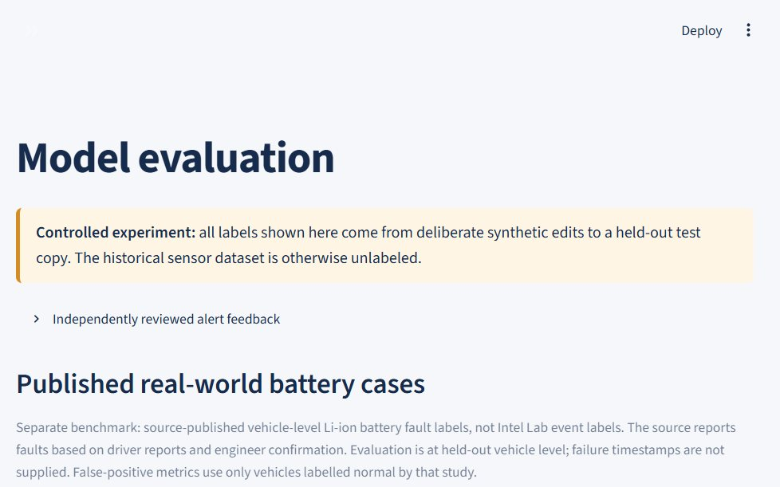

# SensorGuard

[](https://github.com/Nanduposina/SensorGuard/actions/workflows/ci.yml)

**Catch questionable sensor data before it reaches a model.**

SensorGuard is a reproducible quality and anomaly-investigation pipeline for the [Intel Berkeley Research Lab sensor dataset](https://db.csail.mit.edu/labdata/labdata.html). It streams and profiles source records, preserves evidence for malformed or suspicious readings, compares rule checks with an Isolation Forest and a PyTorch autoencoder, and presents findings in a Streamlit dashboard with local human review.

The Intel deployment documents 54 expected mote IDs. The local source file contains 61 observed IDs; SensorGuard retains and flags unexpected IDs rather than forcing the data to match the expected count. Historical Intel readings are unlabeled. Detector alerts are investigation candidates, not verified failures.

## What it does

- Streams plain text or gzip records and preserves raw line evidence.
- Validates timestamps, sensor identifiers, values, duplicates, ordering and sampling gaps.
- Produces configurable rule findings, Isolation Forest scores and PyTorch autoencoder reconstruction errors.
- Uses chronological train/validation/test partitions; fits preprocessing on training rows and calibrates model thresholds on unmodified validation data (not independently verified fault-free).
- Injects seeded synthetic faults into a separate held-out copy and records the changed readings and ground truth.
- Reports feature-reading pair metrics against synthetic labels, no-injection test alert rates, fault-type results and exploratory voltage cases.
- Serves cached data and precomputed results in a six-section Streamlit dashboard; the UI does not train models.

## Architecture



## Results at a glance

### Controlled Intel Lab fault injection

The bounded demo used seed 42, sensor IDs 1 through 4, up to 100 source-order rows per sensor, and two autoencoder epochs. Its test unit is a sensor-feature-reading pair. It contains 11 deliberately modified pairs and 379 unmodified but **unlabeled** pairs.

| Detector | Injected pairs detected | Alerts among 379 unlabeled pairs | Unlabeled alert rate |
|---|---:|---:|---:|
| Rules | 11 / 11 | 80 | 21.1% |
| Isolation Forest | 6 / 11 | 134 | 35.4% |
| Autoencoder | 6 / 11 | 93 | 24.5% |
| Combined rules + Isolation Forest + autoencoder | 11 / 11 | 213 | 56.2% |

Only the injected pairs have known labels. Alerts among the other pairs are descriptive alert counts, not false positives; precision, F1, and false-positive rate are therefore not calculated for this run. Results depend on this bounded sample and injected fault design.

### Separate published EV battery-fault benchmark

This evaluation uses a different dataset and scores one result per held-out vehicle. The brand 3 subset has 9 source-labelled fault vehicles and 91 source-labelled normal vehicles; the test split contains 9 fault-labelled and 18 normal-labelled vehicles.

| Detector | Fault-labelled vehicles detected | Normal-labelled vehicles flagged | Precision | Recall | Vehicle-level false-positive rate |
|---|---:|---:|---:|---:|---:|
| Isolation Forest | 0 / 9 | 0 / 18 | 0.000 | 0.000 | 0.000 |
| Autoencoder | 4 / 9 | 4 / 18 | 0.500 | 0.444 | 0.222 |

These are vehicle-level outcomes, not charging-session or reading-level metrics. Normal labels apply to vehicles as a whole and do not certify every reading as normal. This benchmark does not validate faults in Intel Lab motes. Full label provenance, thresholds, splits, confusion counts, and limitations are in [the resume-claim audit](./docs/RESUME_CLAIM_AUDIT.md).

## Dashboard screenshots

These screenshots were captured from the running Streamlit application with generated experiment and evaluation artifacts:





## Requirements and setup

Python 3.10 or newer and Git are required. The clean demo below was verified with Python 3.12.10 on Windows; CI runs Python 3.11 on Linux. PowerShell is used for the documented Windows commands. Install the package and development/dashboard tools from the repository root:

```powershell
python -m venv .venv
.\.venv\Scripts\Activate.ps1
python -m pip install --upgrade pip
python -m pip install -e ".[dev,dashboard]"
python -m pip check
python -m pytest -q
```

Linux/macOS activation is `source .venv/bin/activate`. CPU inference and training are supported; CUDA is optional. CI uses Python 3.11 and synthetic data only.

The editable installation installs the dependencies declared in `pyproject.toml`, including PyTorch and Streamlit. PyTorch is a large download; allow several hundred megabytes for the environment. The demo writes bounded output under `artifacts/phase4-demo/` and a local SQLite review store under `.sensorguard/`; both are ignored by Git. On the verification machine repeated full profiles took 24.9–58.0 seconds with a 330 MiB peak working set; the four-sensor experiment took 49.1 seconds. Timings depend on hardware and disk speed.

## Data provenance and placement

The source is the [Intel Berkeley Research Lab sensor dataset](https://db.csail.mit.edu/labdata/labdata.html). The original records were collected by the Intel Research Berkeley lab deployment. Cite and acknowledge the dataset documentation when reusing it. This project does not redistribute the raw data. Place the local file at `data.txt/data.txt` or pass a path explicitly. The discovered local source was a 150,910,946-byte plain-text file; it remains unchanged and is excluded from Git.

The records contain date, time, per-sensor epoch sequence, mote ID, temperature, humidity, light and voltage. Epoch is not globally unique. The official page describes IDs 1–54 and notes that data from some motes may be missing or truncated. This local file contains all IDs 1–54, additional IDs 55–58, and isolated IDs 6485, 33117 and 65407. SensorGuard preserves these records and flags IDs outside the configured 1–54 range rather than forcing a 54-sensor count.

The initial profile counted 93,879 rows as short because whitespace collapsing removed empty columns. The raw file uses repeated spaces for missing columns and five trailing spaces on a terminal block of 526 rows. Preserving literal spaces maps all 2,313,682 records to eight positional columns: 92,976 rows have blank light, 373 have blank temperature/humidity/light, four other rows have unusual IDs/blank positions, and the final 526 have blank mote ID and all measurement slots. These 526 rows form the contiguous file suffix. They remain unassigned to any sensor; their physical cause cannot be established from the file. Every row retains its raw text and line number. Explicit empty measurements remain missing values, not discarded rows. The full profile measures 2,312,781 temperature, 2,312,780 humidity, 2,219,804 light and 2,313,156 voltage values. The one-pass profiler also measures 0 repeated (timestamp, sensor ID) keys, 227,392 input-order reversals, and 231,380 consecutive per-sensor intervals over 300 seconds. Under the documented screening bounds, it flags 388,857 temperature, 299,084 humidity, 0 light and 1 voltage values; these are heuristic findings, not confirmed faults. The profiler records elapsed time and peak working set in its report. Out-of-range readings remain in the data.

## Fresh-clone workflow (Windows PowerShell)

Download the [Intel Lab source](https://db.csail.mit.edu/labdata/labdata.html) and place the original `data.txt` at `data.txt/data.txt`. Run these commands from the repository root after installing the development and dashboard extras above. A unique run name keeps generated files out of the source tree and prevents accidental overwrites.

```powershell
$python = ".\.venv\Scripts\python.exe"
$run = "portfolio-$(Get-Date -Format 'yyyyMMdd-HHmmss')"
$sensors = (1..54) -join ","

# Stream a profile to Markdown.
& $python scripts/profile_dataset.py "data.txt/data.txt" --output "artifacts/$run/data_profile.md"

# Clean the complete source with non-destructive flag-and-retain defaults.
& $python scripts/clean_dataset.py "data.txt/data.txt" --output-dir "artifacts/$run/cleaning" --chunk-size 50000

# Run the seeded, chronological experiment with physical-neighbor context.
& $python scripts/run_experiment.py `
  --input "data.txt/data.txt" `
  --output-dir "artifacts/$run/experiment" `
  --sensors $sensors `
  --max-per-sensor 150 `
  --seed 42 `
  --epochs 2 `
  --contextual `
  --peer-radius-meters 8 `
  --peer-minimum 3 `
  --peer-tolerance 120s
```

The full cleaning export requires about 2.7 GB for the two CSV files; a previous Windows run took about 7 minutes 33 seconds and used approximately 300 MiB working set. Runtime depends on storage and hardware. Use `--max-rows 20000` for a bounded cleaning smoke run; that does not replace full-data cleaning.

### Optional published EV battery benchmark

The separate [Figshare record](https://doi.org/10.6084/m9.figshare.23659323) provides the 55 MB `battery_brand3.tar.gz` archive. Download and extract it once; it is not required for the Intel Lab experiment or CI.

```powershell
$evRoot = Join-Path $env:TEMP "$run-ev-data"
New-Item -ItemType Directory -Force -Path $evRoot | Out-Null
$archive = Join-Path $evRoot "battery_brand3.tar.gz"
Invoke-WebRequest -Uri "https://ndownloader.figshare.com/files/41519169" -OutFile $archive
tar -xzf $archive -C $evRoot
$evData = Join-Path $evRoot "battery_brand3"

& $python scripts/evaluate_real_battery.py $evData `
  --archive $archive `
  --output-dir "artifacts/$run/real-battery" `
  --seed 42 `
  --epochs 20 `
  --estimators 200 `
  --threshold-quantile 0.95
```

The expected extracted layout is `battery_brand3/label/all_label.csv`, `battery_brand3/data/*.pkl`, and `battery_brand3/column.pkl`. The run reports vehicle-level metrics; the source does not supply per-reading ground truth.

### Start the dashboard

```powershell
$env:SENSORGUARD_DATA_PATH = "data.txt/data.txt"
$env:SENSORGUARD_PROFILE_PATH = "artifacts/$run/data_profile.md"
$env:SENSORGUARD_EXPERIMENT_DIR = "artifacts/$run/experiment"
$env:SENSORGUARD_REAL_BATTERY_EVAL_DIR = "artifacts/$run/real-battery"
$env:SENSORGUARD_REVIEW_STORE = ".sensorguard/$run.sqlite3"
& $python -m streamlit run app.py
```

Open the local URL printed by Streamlit. Stop the dashboard with `Ctrl+C`. If the optional EV run was skipped, the Model evaluation page explains that no real battery artifact is configured. Outputs under `artifacts/` and the local review store are ignored by Git.

## Reproduce the data pipeline

Profile the dataset without retaining the complete file in memory. The profiler measures field counts, parsed timestamp coverage, sensor counts, feature ranges/missingness and input-order gaps. Its report goes to the ignored `artifacts/` directory.

```powershell
python scripts/profile_dataset.py "data.txt/data.txt"
python scripts/profile_dataset.py "C:\path\to\data.txt.gz"
```

The parser and chunk reader are available from `sensorguard.ingestion`; `validate_frame()` annotates a supplied DataFrame without deleting or repairing suspicious observations. `clean_frame()` applies explicit per-category policies and preserves original values, source line numbers, quality issues, and policy provenance. The streaming `scripts/clean_dataset.py` command writes a retained view plus an all-row provenance export; its default policy flags and retains observations. Duplicate source lines and repeated `(timestamp, sensor ID)` keys are tracked separately; for a duplicate key the first source occurrence is retained and subsequent copies are marked. Keep raw data immutable and treat generated exports as reproducible artifacts.

### Explicit cleaning workflow

`scripts/clean_dataset.py` streams the source in bounded chunks and emits four artifacts: retained observations in `cleaned.csv`, every source row (including excluded rows) with original values and JSON provenance in `provenance.csv`, and machine/human summaries in `cleaning_report.json` and `cleaning_report.md`. It also tracks duplicate keys, exact repeated source lines, gaps, and input-order reversals across chunk boundaries. A duplicate policy keeps the first source occurrence and applies to later repeats. The default is non-destructive `flag`; raw rows are retained and no values are changed.

```powershell
$python = ".venv/Scripts/python.exe"
& $python scripts/clean_dataset.py "data.txt/data.txt" --output-dir artifacts/cleaning-run1 --chunk-size 50000
# Optional bounded real-source smoke run:
& $python scripts/clean_dataset.py "data.txt/data.txt" --output-dir artifacts/cleaning-smoke --max-rows 20000 --chunk-size 5000
# Explicit example: exclude later duplicate timestamp/sensor keys and readings after long gaps:
& $python scripts/clean_dataset.py "data.txt/data.txt" --output-dir artifacts/cleaning-policy-run --policy duplicate_key=drop --policy sampling_gap=drop
```

Supported categories include timestamps, source-order reversals, exact duplicate lines, duplicate `(timestamp, sensor ID)` keys, missing measurements, implausible values, gaps, unexpected sensor IDs, and malformed rows. Each category accepts `preserve`, `flag`, or `drop`. `impute` is limited to missing measurements and requires a separate training-only per-sensor/global median JSON via `--imputation-statistics`; the Python API `fit_imputation_statistics(frame, training_mask)` fits those medians on the caller’s explicit chronological training mask. Imputation uses fixed training medians, not interpolation, and leaves issue/provenance fields intact. All options and thresholds are recorded in the report. Existing nonempty output directories are rejected to prevent accidental overwrites.

## Train detectors and export alerts

The training CLI materializes its input as a DataFrame. Do not pass the complete 2.3-million-row source on a memory-constrained machine. Instead, run the bounded experiment below; it saves the exact unmodified sample to `sampled_records.csv`. Then fit models and export predictions from that sample:

```powershell
python scripts/run_detectors.py artifacts/all_sensors_250/sampled_records.csv `
  --output artifacts/all_sensors_250/trained_predictions.csv `
  --model-dir artifacts/all_sensors_250/models `
  --epochs 3 `
  --threshold-quantile 0.99
```

The command saves `isolation_forest.joblib` and `autoencoder.pt`, and writes chronological test predictions. `sensorguard-detect` is the equivalent installed entry point. Missing values are imputed in model preprocessing; the source records and quality findings remain available in the sampled input.

## Controlled evaluation and metric meaning

Run a deterministic bounded sample experiment across every observed source ID. This includes IDs outside the official expected range; they are kept so the rule detector can surface them. Set the cap and epochs to fit available memory and runtime:

```powershell
$sensorIds = (1..58) + @(6485, 33117, 65407)
$sensors = $sensorIds -join ','
python scripts/run_experiment.py `
  --input "data.txt/data.txt" `
  --output-dir artifacts/all_sensors_250 `
  --sensors $sensors `
  --max-per-sensor 250 `
  --seed 42 `
  --epochs 3
```

The runner scans the source, retains at most the first N source-order rows per requested ID, removes isolated records outside a two-day neighborhood around the selected sample median, and sorts the bounded sample chronologically. It fits on unmodified training data, calibrates model thresholds on the unmodified validation score distribution, and injects faults only into a copy of the held-out test partition. Unmodified does not mean verified fault-free. The evaluation unit is a sensor-feature-reading pair (timestamp-only edits use a record marker). Threshold calibration uses validation data only; final test labels are not used to fit or calibrate. Because only injected modifications have known labels, precision, F1, false-positive rate, true negatives, and PR curves are withheld for this partially labeled set. The report instead gives injected-pair recall, missed injected pairs, and descriptive alert rates on unlabeled readings. It also includes per-fault, per-sensor, detector/feature and rule-contribution breakdowns, distinct alerted-reading counts, and delay for supported span faults. Combined alerts are deduplicated per pair and scored as OR decisions.

The baseline rule, Isolation Forest, and autoencoder path uses training-fitted per-sensor baselines, causal temporal deltas, time-of-day features (Isolation Forest), and multivariate reconstruction/scoring. `--contextual` runs a second detector configuration that supplies peer features to Isolation Forest and the autoencoder and adds a validation-calibrated peer-deviation rule. The contextual feature columns include temperature/humidity/light/voltage deviation from the peer median, robust deviation score, peer count, and median peer age. Preprocessing and sensor-level centers are fitted on training data only; validation and test peers are aligned backward in time with a 120-second tolerance, and injected target values are not used as reference values.

The official dataset documentation provides coordinates for motes 1–54 in meters. SensorGuard uses a configurable Euclidean radius (default 8 m) to form **physical** neighborhoods, not consecutive IDs or statistical similarity. IDs outside 1–54 have no default coordinate references. A JSON `--peer-map` can explicitly override the neighborhood graph. A target never references itself; same-timestamp peers are allowed, future observations are excluded, and context scores remain missing when fewer than three baseline-qualified peers are available. The experiment exports per-sensor/feature coverage so insufficient context is visible rather than scored as normal. Spatial disagreement remains weak evidence because nearby sensors can still experience different local conditions. Source coordinates: [official mote location file](https://db.csail.mit.edu/labdata/mote_locs.txt), linked from the [dataset documentation](https://db.csail.mit.edu/labdata/labdata.html).

Run paired baseline/contextual comparisons with identical data sampling, seed, and model configuration. Use new output directories because existing outputs are protected from overwrite:

```powershell
$python = ".venv/Scripts/python.exe"
$sensors = (1..54) -join ","
& $python scripts/run_experiment.py --input "data.txt/data.txt" --output-dir artifacts/phase5-baseline-run1 --sensors $sensors --max-per-sensor 150 --seed 42 --epochs 2
& $python scripts/run_experiment.py --input "data.txt/data.txt" --output-dir artifacts/phase5-contextual-run1 --sensors $sensors --max-per-sensor 150 --seed 42 --epochs 2 --contextual --peer-radius-meters 8 --peer-minimum 3 --peer-tolerance 120s
& $python scripts/compare_contextual.py --baseline-dir artifacts/phase5-baseline-run1 --contextual-dir artifacts/phase5-contextual-run1 --output artifacts/phase5-contextual-comparison-run1.csv
& $python scripts/analyze_voltage.py "data.txt/data.txt" --output-dir artifacts/phase5-voltage-run1
```

`compare_contextual.py` refuses to compare runs unless dataset SHA-256, seed, selected sensors, split sizes, sampled records, and fault manifests match. Its comparison includes known injected-pair recall, alerts on unlabeled pairs, contextual availability, and elapsed run time. These bounded outcomes do not estimate natural fault prevalence. `scripts/analyze_voltage.py` performs a separate streaming historical investigation using fixed date windows and the partial time coefficient from `voltage ~ temperature + time`; it reports Intel Lab sensor/window candidates, not confirmed Intel mote battery failures. The source documentation warns that voltage is strongly correlated with temperature. Intel Lab has no independently verified failure or confirmed-normal labels, so its unlabeled alerts are not called false positives. A separate EV dataset benchmark below has source-published vehicle-level fault and normal labels; its metrics apply only at the vehicle unit.

The experiment directory contains `sampled_records.csv`, split/test records, injected observations and manifest, per-pair prediction details, detector metrics, no-injection alert baseline, per-fault and per-sensor tables, detector/feature/rule and distinct-reading alert breakdowns, threshold metadata, voltage candidates, plots, and `experiment_report.md`. Unmodified observations have no verified labels, so their alerts are descriptive rather than false-positive counts.

### Larger all-sensor bounded experiment and diagnosis

An earlier full one-pass profile processed 2,313,682 rows in 24.90 seconds with a measured peak working set of 330.0 MiB on this Windows environment. The larger all-sensor bounded evaluation scanned the source and selected up to 250 source-order records for each of the 61 observed IDs, then retained 12,977 rows in its dense time window (1,064 outside-window rows excluded). The chronological split was 7,786 train, 2,595 validation, and 2,596 test rows. It injected 3 events affecting 11 feature-reading pairs, evaluated 12,980 pairs, and completed the detector experiment in about 44 seconds; training/export on the saved sample took about 18 seconds. The saved evaluation threshold quantile was 0.99.

These figures supersede the earlier confusion table, which treated every unmodified reading as a verified negative. That assumption was not supported by the unlabeled source, so the old precision and apparent-FPR values are withdrawn as accuracy claims. The current run has 12,980 sensor-feature-reading pairs, 11 directly modified positives, and 12,969 unlabeled pairs. No real-world precision, F1 or false-positive rate can be established from this sample.

| Detector / ablation | Injected TP / FN | Injection recall | Alerts on unlabeled pairs | Unlabeled alert rate |
|---|---:|---:|---:|---:|
| Rules | 11 / 0 | 1.0000 | 3,014 | 0.2324 |
| Isolation Forest | 0 / 11 | 0.0000 | 818 | 0.0631 |
| Autoencoder | 1 / 10 | 0.0909 | 873 | 0.0673 |
| Quality-rule baseline | 5 / 6 | 0.4545 | 167 | 0.0129 |
| Statistical-rule baseline | 6 / 5 | 0.5455 | 2,847 | 0.2195 |
| Combined rules + IF + AE | 11 / 0 | 1.0000 | 3,754 | 0.2895 |

The 11 injected positives span three synthetic events (one spike, five drift points and five missing-block pairs). Thresholds use the training-fitted preprocessing and the 99th percentile of unmodified validation scores; the final test injections do not participate in fitting or threshold selection. The 12,977-row sample has chronological partitions of 7,786 / 2,595 / 2,596 train/validation/test records. The unlabeled alert rates are descriptive only: an alert outside an injected pair may be a false alert, a natural anomaly, or an unverified condition.

The earlier baseline run (same seed and split) emitted 4,870 rules alert pairs and 5,603 pairs in the all-detector union (including 11 injected pairs). The recalibrated run emits 3,025 rules pairs and 3,765 combined pairs, reductions of 37.9% and 32.8%. These are alert-volume reductions, not demonstrated specificity or precision improvements. The dominant statistical rule, `sensor_baseline_deviation`, fell from 4,673 to 2,812 pairs. Its former fixed robust-z threshold divided by a near-zero `1e-6` MAD floor and caused extreme scores on nearly constant sensor features. The rule now uses training-derived per-feature scale floors and per-feature robust-z cutoffs calibrated at the 99th percentile of validation scores. Floors remain configurable and are safeguards, not physical truth.

In the recalibrated run, the quality-rule ablation generated 172 pairs versus 2,853 for the statistical-rule ablation. Quality rules catch data-integrity and physical-limit conditions; statistical deviations dominate volume and require contextual review. Multivariate detector outputs are record-level scores projected onto present feature rows for investigation. The report and dashboard therefore expose both deduplicated feature-pair alerts and distinct sensor-timestamp readings, plus per-sensor, per-feature, per-rule, and detector contributions. Alert suppression/grouping has not been introduced: repeated findings must remain traceable to the source reading until an operational incident policy is defined.

Historical Intel Lab voltage patterns remain candidates only. Voltage is strongly related to temperature in the dataset; analysis adjusts for a per-sensor linear temperature relationship but cannot make a causal attribution. The optional EV benchmark evaluates a separate population using coarse vehicle-level labels and does not verify any Intel Lab mote failures or failure dates. The detector is an exploratory research pipeline, not an unattended or production-validated alarm system.

### Physical-neighbor contextual comparison (Phase 5)

The current paired run selected up to 150 source-order readings for each official mote ID 1–54, retained 7,693 records in its dense time window, and used the same seed-42 chronological split (4,615 / 1,539 / 1,539) for both configurations. Three synthetic test events modified 11 feature-reading pairs. The comparison artifact is `artifacts/phase5-contextual-comparison-reviewed-20261027.csv`; complete reports and per-sensor tables are in the two run directories. Context coverage was evaluated for 32 sensors; 23 had at least one scored observation with peer features, and mean per-feature test availability was 40.27%.

| Detector | Baseline recall | Baseline unlabeled alert rate | Physical-neighbor recall | Physical-neighbor unlabeled alert rate |
|---|---:|---:|---:|---:|
| Rules | 11/11 | 13.03% | 11/11 | 13.50% |
| Isolation Forest | 0/11 | 2.52% | 0/11 | 0.62% |
| Autoencoder | 1/11 | 3.93% | 1/11 | 1.13% |
| Combined rules + IF + AE | 11/11 | 16.83% | 11/11 | 13.95% |

Recall is measured only against the 11 injected pairs. The other 7,684 pairs are unlabeled, so their alert rates are descriptive and are not false-positive rates. This small, selected synthetic experiment does not show that contextual features improve real-world accuracy. Full-data cleaning and the separate labelled EV battery benchmark are summarized below.

### Separately labelled real-world EV battery benchmark

For real-world labelled evaluation separate from Intel Lab, SensorGuard includes an adapter for the brand 3 subset released with Zhang et al., [*Realistic fault detection of Li-ion battery via dynamical deep learning approach*](https://doi.org/10.1038/s41467-023-41226-5), at [Figshare DOI 10.6084/m9.figshare.23659323](https://doi.org/10.6084/m9.figshare.23659323). The paper describes vehicle-level Li-ion battery fault labels generated from driver reports and confirmed by engineers. The released subset's `all_label.csv` contains 100 vehicles (9 fault-labelled, 91 normal-labelled) and 29,598 charging snippets. These labels do not identify exact failure timestamps or segment-level fault boundaries.

The measured held-out run used seed 42. Vehicle IDs were disjoint across 55 training, 18 validation, and 27 test vehicles; all nine fault-labelled vehicles were held for test alongside 18 test vehicles labelled normal. Training used early mileage-ordered segments for training vehicles, and validation thresholds used only normal validation vehicles. Test labels did not affect model fitting or threshold selection. Detector scores were aggregated to one score per vehicle using the mean of the highest-scoring 10% of that vehicle's segments; the threshold was the 95th percentile of validation-normal vehicle scores. On the 27 held-out vehicles, Isolation Forest detected 0/9 fault-labelled vehicles and flagged 0/18 normal vehicles (precision 0.000, recall 0.000, F1 0.000, vehicle-level FPR 0.000). The autoencoder detected 4/9 and flagged 4/18 source-labelled normal vehicles (precision 0.500, recall 0.444, F1 0.471, vehicle-level FPR 0.222). Isolation Forest's zero FPR reflects its failure to flag any vehicle, not useful detection. Per-vehicle decisions, thresholds, source checksums, and split IDs are in the generated report artifacts.

These metrics are vehicle-level and apply only to this 100-vehicle manufacturer subset; they are not segment-level or event-onset accuracy and do not establish transfer to Intel Lab motes. The normal class is source-labelled at vehicle level, not independently verified as normal at every time point. Intel Lab's historical voltage analysis remains a separate unlabelled candidate study, and no false-positive rate is calculated for those readings.

To reproduce after downloading and extracting `battery_brand3.tar.gz` from the cited Figshare record:

```powershell
python scripts/evaluate_real_battery.py "C:\datasets\battery_brand3" `
  --archive "C:\datasets\battery_brand3.tar.gz" `
  --output-dir artifacts/real-battery-brand3 `
  --seed 42 --epochs 20 --estimators 200 --threshold-quantile 0.95
$env:SENSORGUARD_REAL_BATTERY_EVAL_DIR = "artifacts/real-battery-brand3"
streamlit run app.py
```

The optional external dataset is not downloaded by SensorGuard or CI. It is separately licensed CC BY 4.0; cite the study and data DOI when reusing it. The adapter preserves source vehicle IDs, snippet filenames, mileage order, label provenance, archive hashes, and split metadata.

A smaller four-sensor smoke run (100 rows per ID, seed 42, two epochs) took 49.1 seconds and produced 386 sample rows, 78 test rows, and 3 injected events. Generated artifacts are local under `artifacts/` and excluded from Git. These runs exercise the full detector workflow on a bounded sample, not model training over every raw record.

### Phase 6 full cleaning and 54-mote contextual comparison

The streaming cleaner processed the complete 150,910,946-byte source in about 7 minutes 33 seconds on this Windows host. It read 2,313,682 rows, retained all rows with the default flag-only policy, excluded zero, and wrote `cleaned.csv` plus all-row `provenance.csv` (about 1.35 GB each). The report recorded 752,545 issue-policy flag actions, including 227,392 per-sensor source-order reversals, 231,380 gaps over 300 seconds, 9,866 rows with unexpected IDs, and the profile's missing measurement counts (902 humidity, 93,878 light, 901 temperature, 526 voltage). The 526 records with missing mote ID are preserved and separately flagged. Duplicate-key count is zero per the full profile; the cleaner still checked exact-line and `(timestamp, sensor ID)` duplicates across chunk boundaries. All physical limits remain screening heuristics. A second complete run exited successfully with identical row and issue counts. SHA-256 matched across both runs for the cleaned and provenance CSVs (5A331D993CA8C32074F391919CD1B888E8648F40BCD7BC8B753C7D7E9DB036D6), JSON report (CC97DBE4905B1FA3D0966C9F18CB15F4763DACDECAB7EFBFC10F4B2E3F7205FC), and Markdown report (6D31DB72222A81BE8BDDD957A4A45A644A805B508AAF98E4900B0F8B449D3B8E). The first run took about 7 minutes 33 seconds; the repeated run also completed successfully. Observed process working set was about 300 MiB. Outputs are local and ignored by Git.

The paired baseline and physical-neighbor experiment was rerun on the official IDs 1–54, with up to 150 source-order rows per mote, seed 42, two autoencoder epochs, and identical 4,615/1,539/1,539 chronological splits. Each held-out copy had three seeded fault events modifying 11 feature-reading pairs; the evaluation universe had 7,695 pairs total, of which 11 were labelled injected faults and 7,684 remained unlabeled. Models and preprocessing fit only on training rows; thresholds used validation scores. The paired comparison verified identical source hash, samples, splits, and injection manifests.

| Detector | Baseline injected recall | Baseline alerts on unlabeled pairs | Neighbor-context injected recall | Neighbor-context alerts on unlabeled pairs |
|---|---:|---:|---:|---:|
| Rules | 11/11 | 1,001 (13.03%) | 11/11 | 1,037 (13.50%) |
| Isolation Forest | 0/11 | 199 (2.59%) | 0/11 | 116 (1.51%) |
| Autoencoder | 1/11 | 302 (3.93%) | 1/11 | 87 (1.13%) |
| Combined rules + IF + AE | 11/11 | 1,316 (17.13%) | 11/11 | 1,151 (14.98%) |

The three injected events are synthetic test faults, not naturally observed labelled incidents. All remaining test pairs are unlabeled, so these counts and rates are not false positives or specificity. The context run scored 32 motes; at least one peer feature was available for 23 of the 54 selected motes, and mean per-feature-reading availability was 40.27%. Context did not increase injected-fault recall; the lower combined unlabeled alert rate is descriptive only. Baseline and contextual run files, per-sensor/feature breakdowns, thresholds, and the comparison CSV are in the ignored `artifacts/phase6-*` directories.

The latest fresh-artifact demo used the documented PowerShell script, Python 3.12.10, seed 42, sensors 1–4, 100 rows per sensor, and two autoencoder epochs. Full profiling completed in 63.95 seconds (2,313,682 rows, 61 observed IDs); the bounded experiment completed in 35.42 seconds. It retained 386 sample rows (14 outside its dense window), split into 231 train / 77 validation / 78 test records, and injected three events that modified 11 feature-reading pairs. There were 390 evaluated test pairs: 11 known injected positives and 379 unlabeled pairs. The combined rules + Isolation Forest + autoencoder detector found 11/11 injected pairs and flagged 213/379 unlabeled pairs (56.2% descriptive alert rate). Rules found 11/11 and flagged 80 (21.1%); Isolation Forest found 6/11 and flagged 134 (35.4%); the autoencoder found 6/11 and flagged 93 (24.5%). These are synthetic-injection results; the 379 readings are not verified negatives, so precision, F1 and false-positive rate are not calculated. Threshold quantile was 0.99, fit/calibrated without test labels; exact splits and thresholds are in the generated `experiment_metadata.json` and `metrics.csv`.

## Dashboard

```powershell
$env:SENSORGUARD_DATA_PATH = "data.txt/data.txt"
$env:SENSORGUARD_EXPERIMENT_DIR = "artifacts/all_sensors_250"
$env:SENSORGUARD_PROFILE_PATH = "artifacts/data_profile.md"
$env:SENSORGUARD_MODEL_DIR = "artifacts/all_sensors_250/models"
streamlit run app.py
```

Overview displays available profile and experiment outputs; Sensor explorer plots bounded sensor readings and peer references; Alert investigation filters and exports precomputed findings; Alert review collects independent labels; Model evaluation separates synthetic metrics from unlabeled case studies and matched human reviews; Sensor health summarizes completeness, gaps, alerts and candidate voltage signals. Missing artifacts or data produce actionable empty states. Set `SENSORGUARD_DATA_PATH`, `SENSORGUARD_EXPERIMENT_DIR`, `SENSORGUARD_PROFILE_PATH`, `SENSORGUARD_MODEL_DIR` and `SENSORGUARD_REVIEW_STORE` to configure paths. The data has no timezone metadata and the dashboard presents timestamps as recorded.

## Fresh-clone end-to-end demo (Windows PowerShell)

Download the Intel Berkeley dataset from the official [dataset page](https://db.csail.mit.edu/labdata/labdata.html) and place the original text file at `data.txt/data.txt` (or supply another path). SensorGuard does not download or redistribute the dataset. From a fresh clone, these commands install into a new environment, profile the source, run a deterministic bounded experiment, and launch the dashboard:

```powershell
py -3.12 -m venv .venv
.\.venv\Scripts\Activate.ps1
python -m pip install --upgrade pip
python -m pip install -e ".[dev,dashboard]"
python -m pip check
./scripts/demo.ps1
```

The demo script accepts `-InputPath`, `-Python`, `-Port`, `-OutputDirectory`, and `-ReviewStorePath`; for example, `./scripts/demo.ps1 -InputPath "D:\datasets\data.txt.gz" -Python .\.venv\Scripts\python.exe -Port 8502 -OutputDirectory artifacts\phase4-demo-run2 -ReviewStorePath .sensorguard\phase4-run2.sqlite3`. It refuses to proceed when the input is missing, profiles it to `<OutputDirectory>/data_profile.md`, and runs the experiment on sensors 1–4 with a 100-row per-sensor cap, seed 42 and two autoencoder epochs. Outputs are local under `<OutputDirectory>/experiment/`. It refuses to use an output folder containing files or an existing review database, so reruns must choose a new path and prior reports/reviews are not overwritten. No prior `phase2_improved` or `phase3-demo` artifacts are required.

When the dashboard opens at `http://localhost:8501`, use **Alert investigation** to filter unmodified alerts, then open **Alert review**. This bounded run contains multiple reviewable unmodified alerts: select different alerts and save one as **Confirmed anomaly**, one as **Normal behavior**, and one as **Uncertain / needs investigation**; add notes if useful. Revisit a saved alert by selecting it and update its decision. Use **Download review backup (JSON)** to save a backup outside the repository. To test restore, choose the backup file under **Import a SensorGuard review JSON**, click **Import review file**, and explicitly enable overwrite only if replacing matching IDs is intended. The page reports imported and replaced counts; malformed files and unconfirmed conflicts are rejected without partial writes. **Model evaluation** shows synthetic injected labels separately from the unmodified and human-reviewed historical alerts. Its human-feedback summary is conditional on selected predicted alerts; the normal-labelled share among reviewed alerts is not a false-positive rate because non-alert readings are not systematically reviewed. Do not use injected test-copy alerts as historical review labels.

The script serves all six sections using the generated artifacts: Overview, Sensor explorer, Alert investigation, Alert review, Model evaluation and Sensor health. To rerun only a stage, use the profiler and experiment commands under the corresponding sections above and point `SENSORGUARD_EXPERIMENT_DIR` and `SENSORGUARD_PROFILE_PATH` to the outputs. The output directory may be deleted and regenerated; the raw dataset is never modified.

### Alert-review storage and interpretation

Open **Alert review**, filter the unmodified historical alert list, select an alert, inspect its sensor, recorded timestamp, feature value, detector, score/severity and explanation, then choose a review label. Add optional evidence notes and press **Save review decision**. A saved decision can be revisited and updated. The page excludes predictions from the synthetic-injection copy so generated test faults cannot be mistaken for historical findings. The Model evaluation page separately reports the class balance and confirmation rate among matched, binary-reviewed alerts; this selected-alert rate is descriptive, not recall or dataset-wide precision.

By default, feedback is stored in `.sensorguard/reviews.sqlite3`, separate from raw readings, prediction files and model artifacts. Set `SENSORGUARD_REVIEW_STORE` to use another local path. The `.sensorguard/` directory is ignored by Git. Use **Download review backup (JSON)** to export a versioned portable backup. Import validates the schema, labels, identities, timestamps and duplicate IDs before writing. If imported IDs already exist, import stops without writing anything unless the reviewer explicitly checks the overwrite confirmation. Store updates and imports use SQLite transactions.

Alert IDs are SHA-256 hashes of the recorded timestamp, sensor ID, feature, observed value and detector identity. Scores and explanations are omitted so recalibrating a detector does not change identity for the same reading and detector. A changed value, sensor, timestamp, feature or detector yields a different ID. Current prediction exports do not contain a unique raw-line identifier, so physically duplicated source rows with identical identity fields cannot be distinguished; they collapse to one reviewable identity. Reviews only match the current evaluation artifact when its alert ID matches exactly. Uncertain and unlabeled examples are excluded from binary reviewed-alert summaries. Feedback never retrains a detector, changes thresholds, or enters the synthetic-test metrics. Back up the JSON export somewhere separate from this working directory; local reviews are not synchronized or encrypted by SensorGuard.

For screenshots, launch the app, open each sidebar section and capture the browser view. Label any screenshots showing injected faults as synthetic evaluation results.

## Development and CI

```powershell
ruff check .
ruff format --check .
python -m pytest -q
```

GitHub Actions installs the package with dashboard/development extras, runs Ruff lint and format checks, executes the test suite and explicitly runs the small end-to-end experiment. The CI job does not use the local raw dataset, trained checkpoints or GPU. Use the same commands locally before submitting changes.

## Limitations and next steps

The rule limits are configurable heuristics; contextual differences can reflect legitimate local conditions. The bounded experiment is sensitive to sample window and injection choices, and its alerts on unlabeled Intel readings cannot be called false alarms. The EV battery labels are vehicle-level and lack event boundaries; only nine fault-labelled vehicles occur in the evaluated brand subset. The convenience detector-training script loads its complete input in memory. Broader independently documented failures, exact event intervals, representative confirmed-normal observation windows, calibrated operational thresholds, streaming model training, and cross-population validation are needed before operational use.
