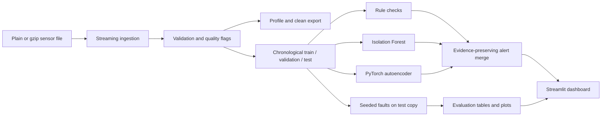

# SensorGuard

SensorGuard is a reproducible data-quality and anomaly-investigation pipeline for the Intel Berkeley Research Lab sensor dataset. It keeps malformed and suspicious readings auditable, evaluates detectors against controlled synthetic faults, and provides an interactive Streamlit dashboard. The historical data is unlabeled: naturally occurring patterns are candidates for investigation, not verified failures.

CI runs on pushes and pull requests through [GitHub Actions](./.github/workflows/ci.yml). A repository-specific badge can be added after publishing this folder to a known GitHub owner/repository.

## What it does

- Streams plain text or gzip records and preserves raw line evidence.
- Validates timestamps, sensor identifiers, values, duplicates, ordering and sampling gaps.
- Produces configurable rule findings, Isolation Forest scores and PyTorch autoencoder reconstruction errors.
- Uses chronological train/validation/test partitions; fits preprocessing on training rows and calibrates model thresholds on unmodified validation data (not independently verified fault-free).
- Injects seeded synthetic faults into a separate held-out copy and records the changed readings and ground truth.
- Reports feature-reading pair metrics against synthetic labels, no-injection test alert rates, fault-type results and exploratory voltage cases.
- Serves cached data and precomputed results in a five-section Streamlit dashboard; the UI does not train models.

## Architecture



## Requirements and setup

Python 3.10 or newer is required. Install the package and development/dashboard tools from the repository root:

```powershell
python -m venv .venv
.\.venv\Scripts\Activate.ps1
python -m pip install --upgrade pip
python -m pip install -e ".[dev,dashboard]"
python -m pytest -q
```

Linux/macOS activation is `source .venv/bin/activate`. CPU inference and training are supported; CUDA is optional. CI uses Python 3.11 and synthetic data only.

## Data provenance and placement

The source is the [Intel Berkeley Research Lab sensor dataset](https://db.csail.mit.edu/labdata/labdata.html). The original records were collected by the Intel Research Berkeley lab deployment. Cite and acknowledge the dataset documentation when reusing it. This project does not redistribute the raw data. Place the local file at `data.txt/data.txt` or pass a path explicitly. The discovered local source was a 150,910,946-byte plain-text file; it remains unchanged and is excluded from Git.

The records contain date, time, per-sensor epoch sequence, mote ID, temperature, humidity, light and voltage. Epoch is not globally unique. The official page describes IDs 1–54 and notes that data from some motes may be missing or truncated. This local file contains all IDs 1–54, additional IDs 55–58, and isolated IDs 6485, 33117 and 65407. SensorGuard preserves these records and flags IDs outside the configured 1–54 range rather than forcing a 54-sensor count.

The initial profile counted 93,879 rows as short because whitespace collapsing removed empty columns. The raw file uses repeated spaces for missing columns and five trailing spaces on a terminal block of 526 rows. Preserving literal spaces maps all 2,313,682 records to eight positional columns: 92,976 rows have blank light, 373 have blank temperature/humidity/light, four other rows have unusual IDs/blank positions, and the final 526 have blank mote ID and all measurement slots. These 526 rows form the contiguous file suffix. They remain unassigned to any sensor; their physical cause cannot be established from the file. Every row retains its raw text and line number. Explicit empty measurements remain missing values, not discarded rows. The full profile measures 2,312,781 temperature, 2,312,780 humidity, 2,219,804 light and 2,313,156 voltage values.

## Reproduce the data pipeline

Profile the dataset without retaining the complete file in memory. The profiler measures field counts, parsed timestamp coverage, sensor counts, feature ranges/missingness and input-order gaps. Its report goes to the ignored `artifacts/` directory.

```powershell
python scripts/profile_dataset.py "data.txt/data.txt"
python scripts/profile_dataset.py "C:\path\to\data.txt.gz"
```

The parser and chunk reader are available from `sensorguard.ingestion`; `validate_frame()` annotates rows without deleting suspicious observations. `clean_frame()` creates a derived representation while carrying issue evidence forward. Keep raw data immutable and treat generated exports as reproducible artifacts.

## Train detectors and export alerts

```powershell
python scripts/run_detectors.py "data.txt/data.txt" `
  --output artifacts/detections.csv `
  --model-dir artifacts/models `
  --epochs 30
```

Editable installation also provides the equivalent `sensorguard-detect` command.

This convenience command currently materializes its input into a DataFrame before chronological splitting. For the 151 MB source and larger data, use the bounded streaming experiment runner below or prepare a documented subset; avoid running full-data model fitting on memory-constrained machines. Checkpoints and detections are generated under ignored artifact paths.

## Controlled evaluation and metric meaning

Run a deterministic bounded sample experiment (seed, sensor subset, per-sensor cap and epochs are configurable):

```powershell
python scripts/run_experiment.py `
  --input "data.txt/data.txt" `
  --output-dir artifacts/experiment `
  --sensors 1,2,3,4 `
  --max-per-sensor 500 `
  --seed 42 `
  --epochs 12
```

The runner streams a bounded number of rows per selected sensor, chronologically partitions the sample, fits on unmodified training data, calibrates thresholds on the unmodified validation score distribution, and injects faults only into a copied test partition. “Unmodified” means no synthetic edits; it does not prove historical records are fault-free. The evaluation unit is a sensor-feature-reading pair (timestamp-only edits use a record marker). It reports precision, recall, F1, apparent false-positive rate, confusion counts, sample/event counts, PR curves for individual detectors, per-fault and per-sensor metrics, and delay for supported span faults. For controlled metrics, pairs without an injected label are treated as negatives; naturally occurring anomalies may therefore count as apparent false positives. Combined alerts are deduplicated per pair and scored as OR decisions; their maximum scores combine incomparable scales, so combined PR-AUC is undefined and omitted. The no-injection held-out scores are a baseline on unlabeled historical data, not a verified false-alarm rate.

Synthetic labels are known because the experiment created those edits. Fault types, magnitudes and timing are experimenter-selected and do not represent natural prevalence or all real failure processes. Historical records have no verified anomaly labels. Voltage depends strongly on temperature according to the dataset documentation; candidate voltage trends are temperature-adjusted exploratory analyses. No battery failure is confirmed without independent battery/maintenance ground truth. Anomaly scores are not failure probabilities.

### Example measured run

The latest audit run used seed 42, sensors 1–4, a 100-record-per-sensor cap and two autoencoder epochs. After excluding 14 records outside the selected dense time window, it evaluated 386 sample rows (231 train, 77 validation, 78 test), 3 injected events and 11 positive feature-reading pairs out of 390 evaluated pairs. On the injected test, the all-detector OR had precision 0.052, recall 1.000 and apparent FPR 0.533; its no-injection test alert rate was 0.546. Individual rule, Isolation Forest and autoencoder no-injection alert rates were 0.285, 0.195 and 0.267. These non-injected pairs are unlabeled historical readings, so those rates are not verified error rates. This bounded experiment shows many alerts relative to the chosen injections and is not deployment-ready evidence. In this sample the voltage analysis marked one temperature-adjusted decline candidate and three abrupt-change candidates; these are unverified historical patterns, not battery failures.

Recreate the detailed tables and plots with the command above. The example report and outputs are local generated artifacts and are not checked into source control.

## Dashboard

```powershell
streamlit run app.py
```

Overview displays available profile and experiment outputs; Sensor explorer plots bounded sensor readings and peer references; Alert investigation filters and exports precomputed findings; Model evaluation separates synthetic metrics from unlabeled case studies; Sensor health summarizes completeness, gaps, alerts and candidate voltage signals. Missing artifacts or data produce empty states. Set `SENSORGUARD_DATA_PATH`, `SENSORGUARD_EXPERIMENT_DIR`, `SENSORGUARD_PROFILE_PATH` and `SENSORGUARD_MODEL_DIR` to configure paths. The data has no timezone metadata and the dashboard presents timestamps as recorded.

For screenshots, launch the app, open each sidebar section and capture the browser view. Label any screenshots showing injected faults as synthetic evaluation results.

## Development and CI

```powershell
ruff check .
ruff format --check .
python -m pytest -q
```

GitHub Actions installs the package with dashboard/development extras, runs Ruff lint and format checks, executes the test suite and explicitly runs the small end-to-end experiment. The CI job does not use the local raw dataset, trained checkpoints or GPU. Use the same commands locally before submitting changes.

## Limitations and next steps

The rule limits are configurable heuristics; contextual differences can reflect legitimate local conditions. The bounded experiment is sensitive to sample window and injection choices, and its measured false-alarm rates are currently high. The convenience detector-training script loads its complete input in memory. Better labeled field failures, calibrated operational thresholds, streaming model training, broader sensor/time coverage and independent battery ground truth are needed before operational use.
